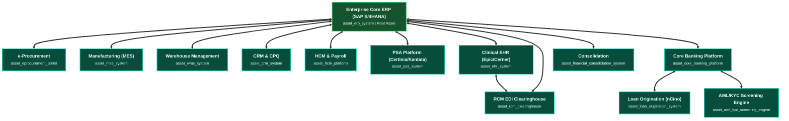

# Architecture Specification: The Enterprise Value Chain

The **Enterprise Value Chain** represents the foundational transactional, operational, and accounting spine of an enterprise. It unifies **eleven major lifecycles** across **five composable industry profiles** into an end-to-end, structurally linked ecosystem spanning cross-industry back-office (`core`), discrete manufacturing (`manufacturing`), professional services (`professional_services`), healthcare providers (`healthcare`), and commercial/retail banking (`financial_services`).

```mermaid
flowchart LR
  subgraph P2M ["<b>Plan-to-Make (P2M)</b>"]
    direction TB
    P_DMD["Demand Sensing"] --> P_MRP["MRP Planning"]
    P_MRP --> P_MFG["Manufacturing"]
    P_MFG --> P_PUT["Finished Goods Put-away"]
  end

  subgraph S2P ["<b>Source-to-Pay (S2P)</b>"]
    direction TB
    S_CONT["Contracting & SLA"] --> S_PO["Purchase Order"]
    S_PO --> S_GR["Goods Receipt"]
    S_GR --> S_INV["Invoice Match"]
    S_INV --> S_PAY["Payment Disbursement"]
  end

  subgraph O2C ["<b>Order-to-Cash (O2C)</b>"]
    direction TB
    O_ORD["Order Entry"] --> O_CRD["Credit Check"]
    O_CRD --> O_WMS["Fulfillment"]
    O_WMS --> O_BIL["Customer Invoicing"]
    O_BIL --> O_CSH["Cash Reconciliation"]
  end

  subgraph H2R ["<b>Hire-to-Retire (H2R)</b>"]
    direction TB
    H_REQ["Job Requisition"] --> H_ONB["Onboarding"]
    H_ONB --> H_PAY["Payroll & Benefits"]
    H_PAY --> H_OFF["Offboarding"]
  end

  subgraph L2C ["<b>Lead-to-Cash (L2C)</b>"]
    direction TB
    L_QUAL["Lead Qualification"] --> L_PROP["Proposal Scoping"]
    L_PROP --> L_CONT["Contract Review"]
    L_CONT --> L_DEAL["Deal Handover"]
  end

  subgraph E2C ["<b>Engagement-to-Cash (E2C)</b>"]
    direction TB
    E_KICK["Project Kickoff"] --> E_STAFF["Resource Scheduling"]
    E_STAFF --> E_DELIV["Milestone Delivery"]
    E_DELIV --> E_TIME["Time & Expense"]
    E_TIME --> E_ACPT["Client Acceptance"]
    E_ACPT --> E_BILL["Project Billing"]
    E_BILL --> E_CLS["Project Closure"]
  end

  subgraph P2D ["<b>Patient-to-Discharge (P2D)</b>"]
    direction TB
    D_REG["Registration & Prior Auth"] --> D_TRI["Admission & Triage"]
    D_TRI --> D_CARE["Care Delivery (CPOE)"]
    D_CARE --> D_DIS["Discharge Transition"]
  end

  subgraph RCM ["<b>Revenue Cycle Mgmt (RCM)</b>"]
    direction TB
    M_COD["Charge Capture & Coding"] --> M_CLM["837 Claim Submission"]
    M_CLM --> M_ADJ["ERA 835 & Denials"]
    M_ADJ --> M_CSH["Cash Posting"]
  end

  subgraph C2A ["<b>Client-to-Account (C2A)</b>"]
    direction TB
    C_INT["Prospect Intake"] --> C_KYC["CIP & 25% UBO"]
    C_KYC --> C_AML["OFAC/PEP & EDD"]
    C_AML --> C_ACT["Core Account Activation"]
  end

  subgraph L2S ["<b>Loan-to-Settlement (L2S)</b>"]
    direction TB
    B_APP["Loan Packaging"] --> B_UND["PD/LGD Underwriting"]
    B_UND --> B_COL["Collateral & Lien"]
    B_COL --> B_FND["Booking & Fedwire"]
    B_FND --> B_SRV["Servicing & Workout"]
  end

  subgraph R2R ["<b>Record-to-Report (R2R)</b>"]
    direction TB
    R_GL["GL Journal Ingestion"] --> R_IC["Intercompany Elimination"]
    R_IC --> R_REC["Balance Sheet Substantiation"]
    R_REC --> R_CLS["Close & Consolidation"]
    R_CLS --> R_RPT["Statutory Disclosures"]
  end

  S_GR -.->|Raw Materials| P_MFG
  S_GR -.->|Medical Supplies| D_CARE
  S_CONT -.->|Appraisal Panel SLAs| B_COL
  P_PUT -.->|Available to Promise (ATP)| O_WMS
  L_DEAL -.->|Engagement Handover| E_KICK
  D_DIS -.->|Encounter Charges| M_COD
  C_ACT -.->|Verified CIF| B_APP
  S_PAY ==>|AP Subledger Feed| R_GL
  O_CSH ==>|AR Subledger Feed| R_GL
  H_PAY ==>|Payroll Expense Feed| R_GL
  H_OFF ==>|Severance Feed| R_GL
  E_BILL ==>|Services Invoicing Feed| R_GL
  M_CSH ==>|Patient AR Cash Feed| R_GL
  B_SRV ==>|Loan Subledger & CECL Feed| R_GL

  classDef p2mBox fill:#312e81,stroke:#6366f1,stroke-width:2px,color:#e0e7ff;
  classDef s2pBox fill:#0f172a,stroke:#38bdf8,stroke-width:2px,color:#f8fafc;
  classDef o2cBox fill:#1e1b4b,stroke:#a855f7,stroke-width:2px,color:#f3e8ff;
  classDef h2rBox fill:#4c1d95,stroke:#8b5cf6,stroke-width:2px,color:#ede9fe;
  classDef r2rBox fill:#064e3b,stroke:#34d399,stroke-width:2px,color:#ecfdf5;
  classDef psBox fill:#451a03,stroke:#fbbf24,stroke-width:2px,color:#fef3c7;
  classDef hcBox fill:#083344,stroke:#22d3ee,stroke-width:2px,color:#ecfeff;
  classDef fsBox fill:#3b0764,stroke:#e879f9,stroke-width:2px,color:#fae8ff;

  class P_DMD,P_MRP,P_MFG,P_PUT p2mBox;
  class S_CONT,S_PO,S_GR,S_INV,S_PAY s2pBox;
  class O_ORD,O_CRD,O_WMS,O_BIL,O_CSH o2cBox;
  class H_REQ,H_ONB,H_PAY,H_OFF h2rBox;
  class R_GL,R_IC,R_REC,R_CLS,R_RPT r2rBox;
  class L_QUAL,L_PROP,L_CONT,L_DEAL,E_KICK,E_STAFF,E_DELIV,E_TIME,E_ACPT,E_BILL,E_CLS psBox;
  class D_REG,D_TRI,D_CARE,D_DIS,M_COD,M_CLM,M_ADJ,M_CSH hcBox;
  class C_INT,C_KYC,C_AML,C_ACT,B_APP,B_UND,B_COL,B_FND,B_SRV fsBox;
```

---

## 1. Architectural Foundations & Principles

1. **Subledger-to-General-Ledger Invariance**: Operational subledgers (Accounts Payable in S2P, Accounts Receivable in O2C, Payroll in H2R, Consulting Billing in E2C, Patient Accounting in RCM, and Core Banking Loan/Deposit Subledgers in L2S) never write directly to final statutory trial balances. All subledger activity posts as debit/credit journal vouchers into General Ledger (`r2r_001_journal_entry_recording`), maintaining complete audit trails.
2. **Double-Entry Balance Constraint**: In accordance with GAAP and IFRS principles, every transaction ingested or generated within the engine must enforce:
   $$\sum \text{Debits} - \sum \text{Credits} = 0$$
3. **Strict Separation of Duties (SoD) & Threshold Reconciliation**: The Accountable (A) and Responsible (R) roles on a single process step cannot be the same entity unless an explicit `compensating_control` is documented in the node's frontmatter, and the Accountable role's `approval_limit_usd` must be $\ge$ the step's `approval_threshold_usd`.
4. **Capacity & Flow Physics**: Material, clinical, and financial queues across all lifecycles are subject to capacity constraints modeled via `volume_per_period` and `capacity_fte`. 

---

## 2. Cross-Lifecycle Integration Mechanics

### A. Operational Flow Across Industry Profiles
- **Discrete Manufacturing (`manufacturing`)**: Raw materials are procured through **S2P** (`s2p_006_goods_services_receipt`), fed into **P2M** (`p2m_004_manufacturing_execution`), transformed into finished goods, and put away in `p2m_006_finished_goods_putaway`, supplying Available-to-Promise (ATP) inventory to **O2C** (`o2c_003_inventory_allocation_fulfillment`).
- **Professional Services (`professional_services`)**: Commercial opportunities are scoped and contracted in **L2C** (`l2c_001` through `l2c_004`), producing the Statement of Work (`data_statement_of_work`), which triggers project delivery initiation in **E2C** (`e2c_001_project_kickoff`).
- **Healthcare Provider & Clinical Systems (`healthcare`)**: Medical and surgical supplies received in **S2P** (`s2p_006`) patch directly into inpatient clinical care delivery in **P2D** (`p2d_004_care_delivery_order_execution`). Discharge transition (`p2d_005`) feeds encounter documentation into **RCM** (`rcm_001_charge_capture_coding`).
- **Financial Services & Banking (`financial_services`)**: Institutional and retail clients onboarded through **C2A** (`c2a_001` through `c2a_005`) receive an active, KYC/AML-cleared Customer Information File (CIF) that feeds directly into commercial credit packaging in **L2S** (`l2s_001_loan_application_credit_packaging`), while vendor SLA contracting (`s2p_004`) patches into collateral valuation (`l2s_003`).

### B. Financial Ingestion (Subledgers $\rightarrow$ R2R)
All external lifecycles act as subledger feeders into **R2R** (`r2r_001_journal_entry_recording`):
- **S2P (`s2p_008`)**: Accounts Payable liability and cash disbursements.
- **O2C (`o2c_004`, `o2c_005`)**: Accounts Receivable assets and cash concentration.
- **H2R (`h2r_004`, `h2r_006`)**: Payroll expenses, tax liabilities, and offboarding settlements.
- **E2C (`e2c_006`)**: Professional services client invoices, time & expense billables, and milestone revenue recognition feeds.
- **RCM (`rcm_006`)**: Hospital ERA 835 remittances, contractual allowances, and patient cash posting.
- **L2S (`l2s_006`)**: Commercial loan interest accruals, fee amortization, principal settlements, and ASC 326 CECL allowance provisions.

---

## 3. Level of Detail (LOD) Three-Tier Framework

Every process milestone across the enterprise adheres to a strict three-tier structure designed for distinct enterprise architecture audiences:

| Tier | Target Stakeholder | Primary Content & Invariants |
| :--- | :--- | :--- |
| **Tier 1** | **Executive / C-Suite** | Capability overview, strategic alignment, corporate outcomes, and business risk profile (fraud, revenue leakage, compliance penalties). |
| **Tier 2** | **Process Architect** | Operational task sequence, RACI execution grid, DACI decision rights, SLAs, business rules, and non-linear exception branching. |
| **Tier 3** | **Simulation Engineer** | System asset bindings, queueing math, throughput constraints (TPS), cycle times, unit costs, error rates, capacity FTE modeling. |

---

## 4. Enterprise IT Asset Topology

The Enterprise operates on an integrated IT asset landscape anchored by Core ERP and specialized domain platforms:



---

## 5. Lifecycle Summary Reference

| Lifecycle ID | Profile | Domain | Milestones | Primary Focus | Key Integrations |
| :--- | :--- | :--- | :---: | :--- | :--- |
| **S2P** | `core` | Procurement & Finance | 8 Steps | RFx, PO Issuance, 3-Way Match, AP Settlement | Feeds P2M, P2D & L2S; Feeds R2R AP Subledger |
| **R2R** | `core` | Accounting & GL | 5 Steps | Journal Ingestion, Intercompany, Close, Consolidation | Root financial ledger for all enterprise subledgers |
| **H2R** | `core` | Human Capital | 6 Steps | Requisition, Onboarding, Payroll, Offboarding | Feeds R2R Payroll Expense and Liabilities |
| **O2C** | `manufacturing` | Sales & Commercial Ops | 5 Steps | Credit Check, Allocation, Fulfillment, Billing | Consumes P2M ATP, Feeds R2R AR Subledger |
| **P2M** | `manufacturing` | Supply Chain & Mfg | 6 Steps | Demand Forecasting, MRP, Shop Execution, Put-away | Ingests from S2P, Feeds O2C ATP Inventory |
| **L2C** | `professional_services` | Prof. Services Sales | 4 Steps | Lead Discovery, Scoping, MSA/SOW Negotiation | Produces SOW, Feeds E2C Kickoff Handover |
| **E2C** | `professional_services` | Prof. Services Delivery | 7 Steps | PSA Scheduling, Delivery, Timesheets, Billing | Feeds R2R AR Subledger and Revenue Recognition |
| **P2D** | `healthcare` | Clinical Inpatient Care | 5 Steps | Registration, Prior Auth, Triage, CPOE Care, Discharge | Ingests S2P supplies, Triggers RCM Charge Capture |
| **RCM** | `healthcare` | Patient Accounting | 6 Steps | Coding, 837 Scrubbing, 835 ERA, Denials, Cash Posting | Feeds R2R Patient Accounting Subledger |
| **C2A** | `financial_services` | Banking KYC & Onboarding | 5 Steps | Intake, CIP/UBO, OFAC/PEP Screening, EDD, DDA Setup | Enables L2S Credit Origination |
| **L2S** | `financial_services` | Lending & Servicing | 6 Steps | Packaging, PD/LGD Underwriting, Liens, Funding, Workout | Ingests S2P SLAs, Feeds R2R Loan Subledger & CECL |
