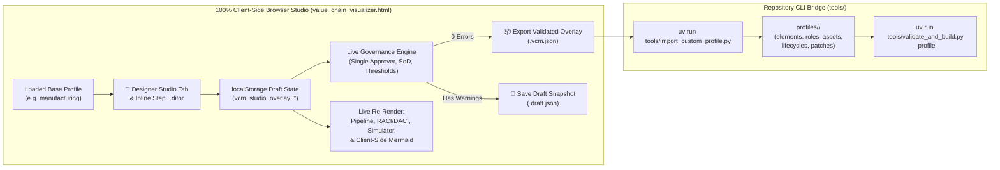

# Implementation Plan: Interactive Lifecycle & Operating Model Designer Studio

## Goal Description

Enable enterprise architects and process designers to **customize existing lifecycles and author their own process steps, enterprise roles, and IT system assets** directly inside the standalone **100% Client-Side Browser Visualizer (`value_chain_visualizer.html`)**, while preserving the repository's **layered profile inheritance architecture (`profiles/<custom>/`)** and strict governance invariants.

### Architectural Workflow



---

## Key Design Decisions (Aligned with User Requirements)

> [!IMPORTANT]
> 1. **100% Client-Side Browser Studio (Serverless SPA)**: All authoring, customization, simulation recalculation, and Mermaid diagram regeneration happen in the browser with `localStorage` persistence and JSON bundle export/import—requiring zero running backend server.
> 2. **Isolated Custom Overlay Profile (`profiles/<custom>/`)**: Customizations never overwrite base profiles (`core`, `manufacturing`, `professional_services`, `healthcare`). Modifying an inherited element, role, asset, or lifecycle automatically records `overrides: <source_layer>`, and new entities are scoped to the child overlay layer.
> 3. **Real-Time Guardrails + Draft Mode**: Users can freely experiment and save drafts in `localStorage` (or download a draft JSON snapshot) while live governance warnings flag Single Approver ($|A|=1$), Segregation of Duties (`R == A` without `compensating_control`), or Role Approval Threshold violations. Exporting a **Validated Profile Overlay** for repository build requires zero blocking governance errors.

> [!NOTE]
> **Pre-Existing Bug Discovered During Research**: In [`tools/export_diagram.py`](file:///mnt/ssd-data/AntigravityData/AG2/ValueChainModel/tools/export_diagram.py#L42-L79), `load_data()` still looks for `lifecycles/`, `simulations/`, and `roles/` in the repository root (pre-Phase 8.5 paths) instead of extracting them from the resolved profile and `knowledge_graph.json`. As a result, `lifecycles`, `scenarios`, and `roleTitles` in the generated HTML were empty (`{}`, `[]`), and `roles` was injected as a dictionary while `visualizer_template.html` iterated over it as an array. **Component 2** fixes this first so the visualizer and Designer Studio have complete, accurate baseline data.

---

## Proposed Changes

### Component 1: Schema Upgrades for Overlay Inheritance (`schema/`)

Allow custom overlay profiles to override inherited lifecycle manifests (when reordering/inserting/removing milestones) and inherited IT system assets using the `overrides` property.

#### [MODIFY] [lifecycle_manifest.schema.json](file:///mnt/ssd-data/AntigravityData/AG2/ValueChainModel/schema/lifecycle_manifest.schema.json)
* Add `"overrides": { "type": "string" }` to `properties`.

#### [MODIFY] [asset_hierarchy.schema.json](file:///mnt/ssd-data/AntigravityData/AG2/ValueChainModel/schema/asset_hierarchy.schema.json)
* Add `"overrides": { "type": "string" }` to `properties`.

---

### Component 2: Exporter Data Hydration Fix (`tools/export_diagram.py`)

Ensure the compiled visualizer HTML receives the full resolved `lifecycles`, `scenarios`, `roles` dictionary, and `role_titles` for the active profile.

#### [MODIFY] [export_diagram.py](file:///mnt/ssd-data/AntigravityData/AG2/ValueChainModel/tools/export_diagram.py)
* Update [`load_data()`](file:///mnt/ssd-data/AntigravityData/AG2/ValueChainModel/tools/export_diagram.py#L25-L80) to:
  * Read `lifecycles` directly from `kg_data.get("lifecycles", {})`.
  * Resolve the profile via `resolve_profile(root / "profiles", profile, root)` (when profile exists in `profiles/`) to load all applicable scenario JSON payloads from `ep.scenario_files`.
  * Populate `role_titles` from `kg_data.get("roles", {})` (`role_obj.get("name")` with fallback to title-cased ID).
* Update `generate_raci_matrix_markdown()`, `generate_daci_matrix_markdown()`, and `generate_mermaid_raci_swimlanes()` to iterate over `sorted(kg_data.get("roles", {}).keys())`.

---

### Component 3: 100% Client-Side Designer Studio (`templates/visualizer_template.html`)

Extend the standalone SPA with a full visual authoring workspace, live governance engine, dynamic Mermaid generator, and overlay export/import controls.

#### [MODIFY] [visualizer_template.html](file:///mnt/ssd-data/AntigravityData/AG2/ValueChainModel/templates/visualizer_template.html)

1. **Header Studio Controls & Draft Status Pill**:
   * Add a header badge showing active customization status (`Base Profile` vs. `Draft Overlay: <custom_id> (N customizations)`).
   * Add quick-action buttons in the header and step detail modal (`✏️ Customize Step` on any process card/modal).

2. **New Tab: `🎨 Designer Studio` (`#tab-designer`)**:
   * **Overlay Profile Configuration Bar**:
     * Set `Custom Profile ID` (e.g., `acme_custom`), `Display Name`, `Base Profile` (auto-bound to current profile), and buttons for:
       * `💾 Save Draft (Browser)`
       * `📂 Import Overlay / Draft (.json)`
       * `🗑️ Reset to Base Profile`
       * `📦 Export Validated Profile Overlay (.vcm.json)` (gated by 0 governance errors)
   * **Live Governance Guardrail Banner**:
     * Real-time status panel evaluating all active/customized elements against:
       * **Single Approver Rule**: Exactly 1 `raci.accountable` and 1 `daci.approver`.
       * **Segregation of Duties (SoD)**: If `Responsible ∩ Accountable != ∅`, flags an SoD violation until `compensating_control` is provided.
       * **Approval Threshold vs. Role Limit**: Verifies that the Accountable role's `approval_limit_usd >= step.approval_threshold_usd`.
       * **Graph & Dependency Integrity**: Verifies `feeds_into`, `governed_by`, and `asset_dependencies` targets exist.
       * **Concentrated Approver Warning**: Advisory warning if a single role is Approver on $\ge 5$ steps in a lifecycle.
   * **Four Interactive Authoring Sub-Panels**:
     * **1. Lifecycle Milestone Sequencer**:
       * Select a lifecycle (e.g., `S2P`, `O2C`, `R2R`, `P2M`, `H2R`, `L2C`, `E2C`, `P2D`, `RCM`), reorder milestones (`↑` / `↓`), assign phase groupings, insert new or existing steps into the sequence, or remove steps from the lifecycle.
     * **2. Process Step Editor (Create New / Override Inherited)**:
       * Form fields for `id`, `name`, `lifecycles`, `phase`, operational metrics (`baseline_cycle_time_hours`, `baseline_cost_per_unit`, `sla_hours`, `automation_rate`, `error_rate`, `approval_threshold_usd`), RACI & DACI role selectors, `compensating_control`, `asset_dependencies` multi-select, `graph_relations` (`feeds_into`, `governed_by`, `exception_to`) editor, and Tier 1 / Tier 2 / Tier 3 Markdown descriptions.
     * **3. Enterprise Roles & Approval Authority Manager**:
       * Add new roles or override existing roles (`id`, `name`, `department`, `approval_limit_usd`, role description).
     * **4. IT System Assets Manager**:
       * Add new IT system assets or override existing assets (`id`, `name`, `asset_type`, `status`, `sla_uptime_percent`, `capacity_max_tps`, `parent_asset_id`).

3. **Client-Side Dynamic Mermaid Generator**:
   * Implement `buildMermaidFlowClient(lifecycleId)`, `buildMermaidRaciClient(lifecycleId)`, and `buildMermaidAssetsClient()` in JS so that whenever the user adds/edits steps, reorders milestones, rewires `feeds_into` links, or adds roles/systems, the **Architecture Diagrams (Mermaid)** tab reflects the customized graph immediately without needing Python rebuilds.

---

### Component 4: Companion CLI Overlay Importer (`tools/import_custom_profile.py`)

Provide a single command to materialize an exported `.vcm.json` bundle from the Browser Studio into a first-class `profiles/<custom_id>/` directory on disk and compile it.

#### [NEW] [import_custom_profile.py](file:///mnt/ssd-data/AntigravityData/AG2/ValueChainModel/tools/import_custom_profile.py)
* CLI usage:
  ```bash
  uv run tools/import_custom_profile.py path/to/acme_custom.vcm.json [--profiles-root profiles] [--output-dir index]
  ```
* Unpacks the bundle into `profiles/<custom_id>/`:
  * Writes `profile.json` and `ontology/taxonomies.json`.
  * Generates Markdown files with compliant YAML frontmatter and Tier 1/2/3 sections in `elements/*.md`, `roles/*.md`, and `assets/*.md` (preserving `overrides: <source_layer>` where applicable).
  * Writes customized lifecycle manifests into `lifecycles/*.json` and cross-layer patches into `patches/*.yaml`.
* Automatically executes `validate_and_build.py --profile <custom_id>` to verify zero schema or governance violations and build `index/<custom_id>/value_chain_visualizer.html`.

---

## Verification Plan

### Automated Tests (`pytest`)
We will add a new test module `tests/test_custom_designer.py` (using `tmp_path` isolation) and run the full test suite:
```bash
uv run ruff check tools/ tests/
uv run pytest -v
```
The automated tests will verify:
1. **Exporter Payload Completeness**: `value_chain_visualizer.html` contains non-empty `lifecycles`, `scenarios`, `roles`, and `roleTitles` payloads, plus the Designer Studio UI functions (`saveOverlayStep`, `validateStudioGovernance`, `exportValidatedOverlayBundle`, `buildMermaidFlowClient`).
2. **Round-Trip Custom Overlay Import & Build**: A synthetic `.vcm.json` bundle exported with a custom role, custom IT asset, modified inherited process step (`overrides: core`), new custom process step wired via `feeds_into`, and reordered lifecycle milestones imports cleanly via `tools/import_custom_profile.py` into `tmp_path` and passes `validate_and_build.py` with zero errors.
3. **Governance Enforcement on Imported Bundles**: Bundles containing an unresolved SoD conflict or Approval Threshold violation are rejected by the validator as expected.

### Manual Verification
1. Open `index/manufacturing/value_chain_visualizer.html` in a browser.
2. Navigate to the **`🎨 Designer Studio`** tab (or click **`✏️ Customize Step`** on any step card).
3. Add a custom role, add a custom IT system, add a new process step wired into `O2C`, and test triggering an SoD conflict (`R == A`) to observe the live guardrail warning and resolve it with a `compensating_control`.
4. Verify that the **Pipeline**, **RACI & DACI Matrix**, **Scenario Simulator**, and **Mermaid Diagrams** tabs immediately reflect the customized model, and export the `.vcm.json` bundle.
